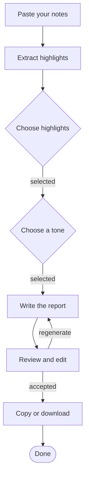

# Workflow graph

The workflow is a directed graph in `workflow` in the spec. The diagram is **generated**, never drawn by hand:

```bash
node scripts/spec.mjs mermaid my-agent.yaml
```

Blue nodes are where a human acts, grey nodes run automatically, green is the end. Paste the output into any Mermaid renderer (GitHub renders it in Markdown fences tagged `mermaid`).

## Node types

| Type | What happens | Needs `ui`? | Auto events |
|---|---|---|---|
| `llm` | A model call | no | `error_raised` |
| `tool` | An external call (API, DB, file) | no | `error_raised` |
| `deterministic` | Plain code: validate, transform, merge | no | none |
| `router` | Pick a branch (model or rules) | no | none |
| `choice` | User picks one or more options | **yes** | `option_selected` |
| `form` | User fills a few structured fields | **yes** | `form_submitted` |
| `review` | User reads, edits, accepts, or regenerates a draft | **yes** | `draft_edited`, `draft_regenerated`, `draft_accepted` |
| `approval` | User approves or rejects a specific action | **yes** | `approval_given`, `approval_rejected` |
| `display` | Show a result or status | **yes** | none |
| `end` | Terminal node | no | none |

Every non-end node also gets `step_started` and `step_completed`.

## Rules

1. **IDs:** `snake_case`, stable, meaningful. They appear in every event as `node_id`. Renaming breaks analytics history.
2. **One purpose per node.** If the title needs "and", split it.
3. **Label branches.** Every edge out of a `choice` or `router` with more than one exit needs a `when`.
4. **Loops are explicit and capped.** A regenerate loop is fine; cap it in the scaffold (for example 3 tries) and give the user an exit.
5. **Every node reaches an end.** The validator rejects dead loops and unreachable nodes.
6. **Failure paths exist.** For each `llm` or `tool` node, decide what the user sees when it fails (in `guardrails.failure_paths`).
7. **Put a human before irreversible actions.** See [guardrails](guardrails.md).

## Design heuristics

- Put the first value-producing step as early as possible. Collect the minimum input, draft, then refine.
- Prefer showing a draft and asking for edits over asking many questions up front.
- Keep a guided flow to roughly 3 to 7 steps. More than that, group or default.
- Add a `router` only when branches really differ in handling.

## Example (from `examples/guided-report-builder`)


